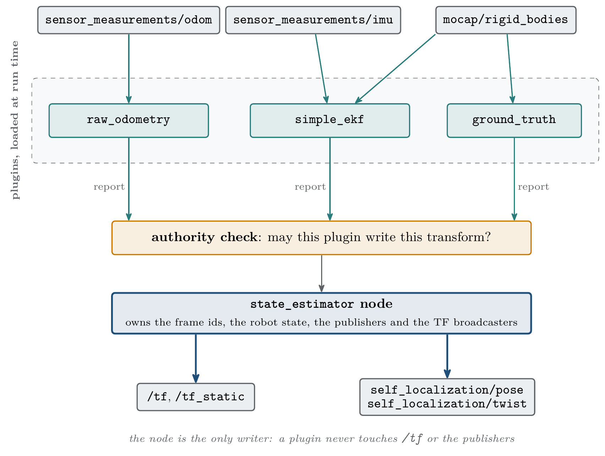
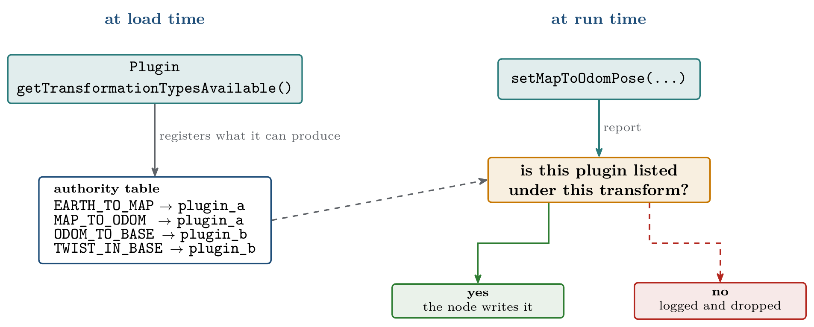
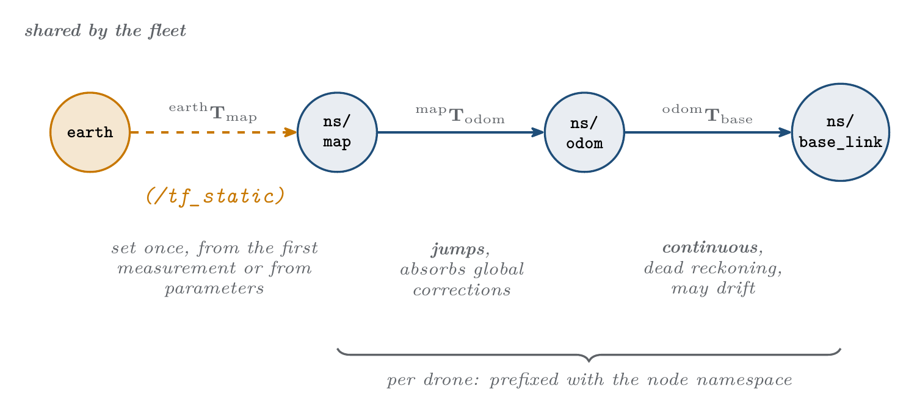

.. _as2_concepts_state_estimator:

===============
State Estimator
===============

.. contents:: Contents
   :depth: 2
   :local:

The State Estimator is the Aerostack2 component in charge of knowing where the aircraft is
and how fast it is moving. It publishes the pose and the twist of the robot on the
:ref:`Self Localization <as2_concepts_as2_communication_self_localization>` channel, and it
builds the `ROS 2 Tf2 <https://docs.ros.org/en/humble/Tutorials/Intermediate/Tf2/Tf2-Main.html>`__
tree that the rest of the system uses to convert between reference frames.

It defines a single ``earth`` frame shared by every drone in the system, and, hanging from
it, the ``map``, ``odom`` and ``base_link`` frames of each one, in that order.

The component itself does not estimate anything. The estimation is done by **plugins**
loaded at run time, which lets the same node serve a simulator, a motion capture rig, an
autopilot odometry or a fused filter without any change outside the configuration file.

.. _as2_concepts_state_estimator_architecture:

------------
Architecture
------------

The ``state_estimator`` node owns the whole output path: the frame names, the robot state,
the publishers and the TF broadcasters. A plugin never writes to ``/tf`` and never touches
the publishers. It **reports** that part of the state has changed, and the node decides
what reaches the outside world.

   The node owns the output path and the plugins feed it

Between the report and the publication sits the authority check. Every plugin declares,
when it is loaded, which parts of the transform chain it is able to produce. The node
records that in a table and consults it on every report:

   How a report is accepted or refused

Because the node arbitrates rather than the plugin, the ``plugin_name`` parameter accepts a
**list** as well as a single name, and several plugins can be loaded into the same node.

.. note::

   The three shipped plugins each declare all four transform types, so loading two of them
   at once means the last report wins rather than a real handover between them. Scoping a
   plugin to part of the chain is the mechanism this design exists for.

.. _as2_concepts_state_estimator_frames:

------
Frames
------

The frame layout follows `REP-105 <https://ros.org/reps/rep-0105.html>`__:

   The transform chain and what each link is responsible for

.. list-table:: Transform chain
   :widths: 25 35 40
   :header-rows: 1

   * - Transform
     - Meaning
     - Behaviour
   * - ``earth`` to ``map``
     - Where this drone's local frame sits inside the global frame
     - Set once at startup, from the first measurement or from parameters. Normally
       published on ``/tf_static``
   * - ``map`` to ``odom``
     - The accumulated correction coming from absolute measurements
     - Jumps whenever a correction arrives
   * - ``odom`` to ``base_link``
     - The smooth, continuous, dead reckoned pose
     - Updated at sensor rate, and may drift

Splitting the chain this way is what makes the output usable by a controller: the
``odom`` to ``base_link`` link is guaranteed to move smoothly, so differentiating it gives
a sane velocity, while every discontinuous jump is confined to ``map`` to ``odom``.

``earth`` is shared by the whole fleet and is never namespaced. ``map``, ``odom`` and
``base_link`` are prefixed with the node namespace, giving ``drone0/map``, ``drone0/odom``
and ``drone0/base_link``.

Empty frame names
=================

A frame name left empty resolves to the node namespace on its own. In a node running under
the namespace ``drone0``, setting

.. code-block:: yaml

   base_frame: ""

gives the frame ``drone0`` rather than ``drone0/base_link``. This is, for example, what
Gazebo expects, since it roots each model's TF at the bare model name.

Reading transforms from a plugin
================================

Plugins read TF through a filtered listener that hides the estimator's own three
transforms. A plugin therefore cannot consume, as if it were a measurement, the output it
has just produced.

.. _as2_concepts_state_estimator_plugins:

-------
Plugins
-------

.. list-table:: State Estimator plugins
   :widths: 20 50 30
   :header-rows: 1

   * - Plugin
     - Use it when
     - Reference
   * - ``raw_odometry``
     - The platform already gives a fused odometry: PX4, DJI, a Crazyflie flow deck, a
       RealSense tracking camera. Optionally anchors the tree to a GPS datum
     - :ref:`raw_odometry <as2_plugins_state_estimator_raw_odometry>`
   * - ``ground_truth``
     - There is a source of absolute, essentially exact pose: a simulator, or a motion
       capture system
     - :ref:`ground_truth <as2_plugins_state_estimator_ground_truth>`
   * - ``simple_ekf``
     - An IMU has to be fused with one or more pose sources, or the pose source is slow,
       noisy or delayed
     - :ref:`simple_ekf <as2_plugins_state_estimator_simple_ekf>`

The plugin is selected with the ``plugin_name`` parameter.

.. _as2_concepts_state_estimator_parameters:

----------
Parameters
----------

These parameters belong to the node itself and stay at the top level of the
``state_estimator`` block:

.. list-table:: State Estimator parameters
   :widths: 30 12 15 43
   :header-rows: 1

   * - Parameter
     - Type
     - Default
     - Description
   * - ``plugin_name``
     - string or string list
     - required
     - Plugin or plugins to load
   * - ``base_frame``
     - string
     - ``base_link``
     - Body frame. An empty string resolves to the node namespace
   * - ``global_ref_frame``
     - string
     - ``earth``
     - Global frame, shared by every drone and never namespaced
   * - ``odom_frame``
     - string
     - ``odom``
     - Odometry frame
   * - ``map_frame``
     - string
     - ``map``
     - Map frame
   * - ``publish_hz``
     - double
     - ``0.0``
     - Output rate in Hz. ``0.0`` publishes on every update
   * - ``<plugin_name>.debug_publish_hz``
     - double
     - ``-1.0``
     - Rate of the per-plugin debug topics. ``-1`` publishes on every update, ``0``
       disables them, a positive value sets a fixed rate

Everything else belongs to the plugin, and lives in a block named after it:

.. code-block:: yaml

   /**:
     ros__parameters:
       plugin_name: "raw_odometry"
       base_frame: "base_link"
       publish_hz: 0.0

       raw_odometry:                              # named after the plugin
         odom_sub_topic: "sensor_measurements/odom"
         use_gps: false

.. warning::

   Unknown keys are ignored without an error. A parameter left at the top level, or
   misspelled, does not stop the node: it starts and runs with the default value. If a
   setting appears to have no effect, check the nesting first. The startup log prints every
   parameter the plugin actually read.

.. _as2_concepts_state_estimator_launching:

---------
Launching
---------

.. code-block:: bash

    # Plugin taken from the configuration file
    ros2 launch as2_state_estimator state_estimator_launch.py \
        namespace:=drone0 \
        config_file:=path/to/config.yaml

    # Plugin given on the command line
    ros2 launch as2_state_estimator state_estimator_launch.py \
        namespace:=drone0 \
        plugin_name:=simple_ekf \
        config_file:=path/to/config.yaml \
        plugin_config_file:=path/to/plugin_config.yaml

``state_estimator_launch.py`` merges three layers of configuration, each one overriding the
previous:

1. ``config/state_estimator_default.yaml``, the node defaults.
2. ``plugins/<plugin_name>/config/plugin_default.yaml``, the plugin defaults.
3. The ``config_file`` and ``plugin_config_file`` given on the command line.

Since the defaults are always merged in, a user configuration only needs to list what it
changes. ``state_estimator_simple_launch.py`` skips the plugin default layer, so a
configuration used with it has to be complete.

.. _as2_concepts_state_estimator_interface:

---------
Interface
---------

The published topics are listed in
:ref:`ROS 2 Common Interfaces <ros2_common_interfaces_state_estimator>`. Which topics are
*subscribed*, and which services are offered, depends entirely on the plugin that is
loaded: see the plugin references above.

To write a plugin of your own, follow the
:ref:`Writing a New State Estimator Plugin <development_tutorials_state_estimator>`
tutorial.
