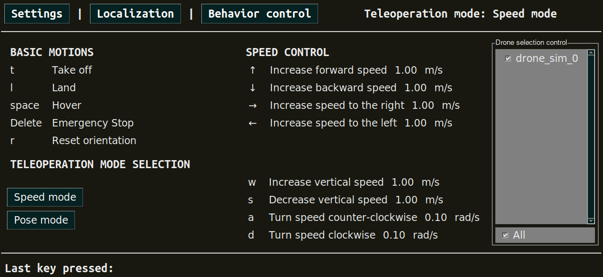

.. _project_crazyflie:

========================
Simple Crazyflie Example
========================

To install this project, please clone the repository:

.. code-block:: bash

   git clone https://github.com/aerostack2/project_crazyflie

To start using this project, please go to the root folder of the project.

----------
Setting up
----------

Before launching the project, let's take a look at the configuration options.
You can find configuation files in the ``config`` folder. The are three configuration files used:

- ``config/config.yaml``: configuration file for the Crazyflie drones.
- ``config/camera_calibration.yaml``: configuration file for the AI deck camera calibration.
- ``config/pid_speed_controller.yaml``: configuration file for the pid controller constants.

By this time, you should only need to modify the ``config/config.yaml`` file.
There are two drone configurations available, one for flying with internal position estimation 
(e.g. flow deck or lighthouse deck) and another for using an external one (e.g. motion capture system).
Depending on the position estimation method, the configuration file should be set accordingly.

The file ships both configurations, the internal one active and the external one commented
out. Uncomment the one you need and comment out the other.

Internal position estimation
============================

The drone estimates its own position, and the
:ref:`raw_odometry <as2_plugins_state_estimator_raw_odometry>` plugin republishes it.

.. code-block:: yaml

   platform:
     ros__parameters:
       external_odom: false

   state_estimator:
     ros__parameters:
       plugin_name: "raw_odometry"

.. list-table:: Internal position estimation configuration
   :widths: 30 30 40
   :header-rows: 1

   * - Parameters
     - Value
     - Description
   * - ``uri``
     - radio://0/80/2M/E7E7E7E7E7
     - Crazyflie URI address (it varies for each drone)
   * - ``external_odom``
     - false
     - Availability of external odometry
   * - ``plugin_name``
     - "raw_odometry"
     - Plugin name for the state estimator

External position estimation
============================

A motion capture system gives the pose, and the
:ref:`ground_truth <as2_plugins_state_estimator_ground_truth>` plugin reads the rigid
bodies directly. The estimated pose is sent back to the drone through
``external_odom_topic``.

.. code-block:: yaml

   platform:
     ros__parameters:
       external_odom: true
       external_odom_topic: "self_localization/pose"

   state_estimator:
     ros__parameters:
       plugin_name: "ground_truth"
       ground_truth:
         mocap_sub_topic: "/mocap/rigid_bodies"
         twist_smooth_filter_cte: 0.1   # (0, 1]; 1 applies no filtering
         rigid_body_name: "1"

.. list-table:: External position estimation configuration
   :widths: 30 30 40
   :header-rows: 1

   * - Parameters
     - Value
     - Description
   * - ``uri``
     - radio://0/80/2M/E7E7E7E7E7
     - Crazyflie URI address (it varies for each drone)
   * - ``external_odom``
     - true
     - Availability of external odometry
   * - ``external_odom_topic``
     - "self_localization/pose"
     - Topic the estimated pose is sent back to the drone on
   * - ``plugin_name``
     - "ground_truth"
     - Plugin name for the state estimator
   * - ``ground_truth.mocap_sub_topic``
     - "/mocap/rigid_bodies"
     - Topic where the mocap data is published
   * - ``ground_truth.rigid_body_name``
     - "1"
     - Name of the rigid body assigned for the drone (it varies for each drone)
   * - ``ground_truth.twist_smooth_filter_cte``
     - 0.1
     - Low-pass constant applied to the twist, which is obtained by differentiating the
       mocap pose

The ``rigid_body_name`` of each drone is set in the per-drone section at the bottom of the
file, since it varies from drone to drone.

Remember to set the correct addresses in the file for each drone,
as indicated in :ref:`aerial_platform_crazyflie_platform_launch`.
Leave only the entries for every drone that will be used, even if it is only one.

.. note::

    For propagating the motion capture system data into the ROS 2 system, we recommend using the
    `mocap4ros2 <https://mocap4ros2-project.github.io/>`_ package.

.. note::

    Both plugins have further parameters. They are documented in the
    :ref:`State Estimator plugins <as2_plugins_state_estimator>` reference.

.. _project_crazyflie_launching:

---------
Launching
---------

The execution on the project is split into two parts: Aerostack2 components and ground station.

Launching Aerostack2
====================

To launch every Aerostack2 component, execute the following command:

.. code-block:: bash

    ./launch_as2.bash

This will open a tmux session with an Aerostack2 instance for each drone launched.

Launcher offers a few options to customize the execution. ``./launch_as2.bash -h`` will show option list. Options can be set with the following flags:

- ``-n``: select drones namespace to launch, values are comma separated. By default, it launches all drones from world description file.
- ``-g``: launch using gnome-terminal. By default not set, uses tmux.

Launching Ground Station
========================

To launch the ground station, execute the following command:

.. code-block:: bash

    ./launch_ground_station.bash

Launcher offers a different pool of options to customize the execution. ``./launch_ground_station.bash -h`` will show option list. Options can be set with the following flags:

- ``-m``: disable launch mocap4ros2. By default set.
- ``-t``: launch keyboard teleoperation. By default not set.
- ``-v``: launch rviz. By default not set.
- ``-r``: record rosbag. By default not set.
- ``-n``: select drones namespace to launch, values are comma separated. By default, it launches all drones from world description file.
- ``-g``: launch using gnome-terminal. By default not set, uses tmux.

Closing
=======

Close all nodes (aerostack2 and ground_station) with the following command:

.. code-block:: bash

    ./stop_tmuxinator.bash

.. note::

    The command ``tmux kill-server`` will have a similar effect but closing all tmux sessions, so be careful if you have other tmux sessions running.
    If launcher was executed with the flag ``-g``, closing should be done manually exiting all gnome-terminal tabs.

Close **only** the Aerostack2 nodes with the following command:

.. code-block:: bash

    ./stop_tmuxinator_as2.bash

Close **only** the ground station nodes with the following command:

.. code-block:: bash

    ./stop_tmuxinator_ground_station.bash

.. _project_tello_mission:

-----------------
Mission execution
-----------------

The project offers a few examples of mission execution.

- **Keyboard Teleoperation control**: Using reactive teleoperation control. For both single and multiagent swarms.
- **Python API missions**: Using Aerostack2 python API for mission definition. For single drone, using GPS and multiple drones.
- **Behavior Tree missions**: Using Behavior Tree as the mission planner. For single drone only.
- **Mission Interpreter**: Using Aerostack2 mission interpreter. For single drone only.

.. _project_tello_keyboard_teleoperation:

Keyboard Teleoperation control
==============================

In order to launch the components for a **single drone**, Aerostack2 launcher does not need any additional flags. Just execute ``./launch_as2.bash``.

Ground station should be launched with ``-t`` flag to enable keyboard teleoperation. Take a look at the :ref:`keyboard teleoperation user guide <user_interfaces_keyboard_teleoperation>` for more information.
A window containing the teleoperation widget should pop up:

   
   Keyboard teleoperation

.. _project_tello_python_api:

Python API missions
===================

In order to launch the components for **multiple drones**, both launchers require the flag ``-n`` indicating drone namespaces to use.

There are three python scripts available for mission execution in the project. For single drone missions, use ``python3 mission.py`` for flying a square.

For multi drone missions, use ``python3 mission_swarm.py`` where a group of drones will fly a swarm coreography. Here it is what the execution looks like:

.. raw:: html

    

        <iframe src="https://www.youtube.com/embed/BlF6rU9R8Nk?si=Bq9o8bO5YAIWfH32" frameborder="0" allowfullscreen style="position: absolute; top: 0; left: 0; width: 100%; height: 100%;"></iframe>
    

.. note::

    To understand how missions are built using the Aerostack2 python API, take a look at the :ref:`development_guide_api_python_api` reference guide.

.. _project_tello_mission_interpreter:

Mission Interpreter
===================

Previous missions were defined using python syntaxis. Aerostask2 offers a mission interpreter that allows mission definition using a JSON format.
Currently, the mission interpreter script at the project is only available for single drone missions.
To launch the mission interpreter, execute ``python3 mission_interpreter.py``.
The execution is similar to the python API mission where the drone will fly a square.

.. _project_tello_behavior_tree:

Behavior Tree
=============

Missions can also be defined using a behavior tree. The project offers a mission example using a behavior tree for a single drone.
To launch the behavior tree mission, execute ``python3 mission_behavior_tree.py``.
The execution is similar to the python API mission where the drone will fly a square.

.. note::

    Trees can be defined using GUIs like `Groot <https://www.behaviortree.dev/groot/>`_.
