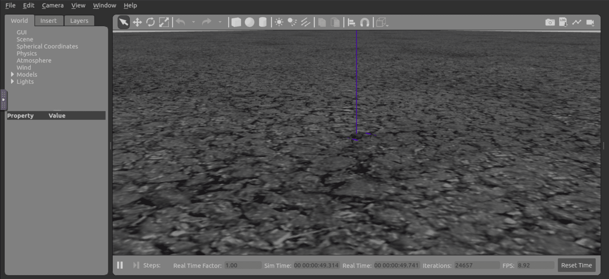

.. _project_px4_vision:

==================
PX4 Vision Example
==================

These examples use the :ref:`Pixhawk Platform <aerial_platform_px4>`.
You can install it following the instructions in :ref:`installation section <aerial_platform_px4_installation>`.

To install this project, please clone the repository:

.. code-block:: bash

   git clone https://github.com/aerostack2/project_px4_vision

To start using this project, please go to the root folder of the project.

.. _project_px4_vision_state_estimator:

----------------------------
Choosing the state estimator
----------------------------

The state estimator is selected in ``config/config.yaml``, under the ``state_estimator``
block. The file ships with four alternatives: one active and three commented out. Uncomment
the one that matches your setup and comment out the rest.

.. list-table:: State estimator alternatives shipped with the project
   :widths: 25 25 50
   :header-rows: 1

   * - Setup
     - Plugin
     - Notes
   * - Indoor, autopilot odometry
     - ``raw_odometry``
     - The active one. Reads the odometry the Pixhawk publishes
   * - Indoor, RealSense
     - ``raw_odometry``
     - Same plugin, pointed at
       ``sensor_measurements/realsense/odom``. Also needs ``external_odom: true`` in the
       ``platform`` block
   * - Indoor, motion capture
     - ``ground_truth``
     - Reads the rigid bodies published by the motion capture system directly
   * - Outdoor, GPS
     - ``raw_odometry``
     - With ``use_gps: true``, which anchors the ``earth`` frame at a geodetic datum

The autopilot odometry, which is the default:

.. code-block:: yaml

   state_estimator:
     ros__parameters:
       plugin_name: "raw_odometry"

A RealSense tracking camera:

.. code-block:: yaml

   state_estimator:
     ros__parameters:
       plugin_name: "raw_odometry"
       raw_odometry:
         odom_sub_topic: "sensor_measurements/realsense/odom"

A motion capture system:

.. code-block:: yaml

   state_estimator:
     ros__parameters:
       plugin_name: "ground_truth"
       ground_truth:
         mocap_sub_topic: "/mocap/rigid_bodies"
         twist_sub_topic: ""             # differentiate the mocap pose to get the twist
         twist_smooth_filter_cte: 0.1    # (0, 1]; 1 applies no filtering
         rigid_body_name: "1"

Outdoor flight with GPS:

.. code-block:: yaml

   state_estimator:
     ros__parameters:
       plugin_name: "raw_odometry"
       raw_odometry:
         use_gps: true
         gps_origin:
           set_origin: "first_gps"   # first_gps, manual or service
           coordinates:              # only used with "manual"
             latitude: 0.0
             longitude: 0.0
             altitude: 0.0

.. note::

    To bring the motion capture data into ROS 2, launch ``mocap4ros2`` together with the
    ground station using the ``-m`` flag. It is configured in
    ``config_ground_station/mocap4r2_optitrack.yaml``, and it feeds the state estimator,
    which turns the pose into the Aerostack2 common interface localization
    :ref:`topics <ros2_common_interfaces_state_estimator_topics>`.

.. note::

    Each plugin has its own set of parameters. They are documented in the
    :ref:`State Estimator plugins <as2_plugins_state_estimator>` reference.

.. _project_px4_vision_execution:

---------
Execution
---------

Aerostack2 nodes run on the onboard computer of each drone. The ground station can run
either on that same computer or on an external one.

Simulation
==========

The simulation uses a docker image that runs Gazebo Garden with the Pixhawk SITL. Build it
once:

.. code-block:: bash

    cd sitl_config/docker && ./docker_build.bash

Configure the simulation in ``sitl_config/world.yaml``, where the world, the number of
drones and their initial positions are set. Then launch it:

.. code-block:: bash

    ./launch_sitl.bash

   Pixhawk SITL simulation

When you are done, close the simulation with:

.. code-block:: bash

    ./stop_tmuxinator_sitl.bash

Micro XRCE Agent
================

The platform talks to the autopilot through the Micro XRCE Agent, one per drone:

.. code-block:: bash

    # Real flight
    MicroXRCEAgent serial -b 921600 --dev /dev/ttyUSB0

    # Simulation
    MicroXRCEAgent udp4 -p 8888

Aerostack2 nodes
================

Launch the Aerostack2 nodes once per drone, changing the namespace with ``-n``:

.. code-block:: bash

    ./launch_as2.bash -n drone0

The flags for the components launcher are:

- ``-n``: select the drone namespace to launch. Default is ``drone0``.
- ``-c``: motion controller plugin, choices are ``pid`` and ``df``. Default is ``pid``.
- ``-x``: launch the micro_xrce_agent for real flights. By default it is not launched.
- ``-r``: record a rosbag. By default it does not record.
- ``-g``: launch using gnome-terminal instead of tmux. By default it is not set.

Ground station
==============

.. code-block:: bash

    ./launch_ground_station.bash -n drone0

The flags for the ground station launcher are:

- ``-n``: drone namespaces, comma separated. Default is ``drone0``.
- ``-t``: launch the keyboard teleoperation. By default it is not launched.
- ``-v``: open rviz. By default it is not opened.
- ``-m``: launch mocap4ros2. By default it is not launched.
- ``-r``: record a rosbag. By default it does not record.
- ``-g``: launch using gnome-terminal instead of tmux. By default it is not set.

Launching it with ``-t`` opens the
:ref:`keyboard teleoperation <user_interfaces_keyboard_teleoperation>` widget:

.. figure:: images/keyboard_teleop_view.png
   :scale: 50
   :class: with-shadow

   Keyboard teleoperation

.. _project_px4_vision_mission:

-----------------
Mission execution
-----------------

The project ships several missions:

.. code-block:: bash

    # Aerostack2 Python API
    python3 mission.py -n drone0

    # Aerostack2 Python API, using GPS
    python3 mission_gps.py -n drone0

    # Aerostack2 Mission Interpreter
    python3 mission_interpreter.py -n drone0

    # Aerostack2 Behavior Trees
    python3 mission_behavior_tree.py -n drone0

.. note::

    ``mission_gps.py`` needs the state estimator configured with ``use_gps: true``, since
    the mission is written in geodetic coordinates.

.. _project_px4_vision_closing:

-------
Closing
-------

.. code-block:: bash

    # Close the Aerostack2 nodes of a drone
    ./stop_tmuxinator_as2.bash drone0

    # Close the ground station
    ./stop_tmuxinator_ground_station.bash

    # Close both
    ./stop_tmuxinator.bash drone0

.. note::

    ``tmux kill-server`` has a similar effect, but it closes every tmux session, so be
    careful if you have others running. If the launchers were executed with the ``-g``
    flag, close the gnome-terminal tabs manually instead.
