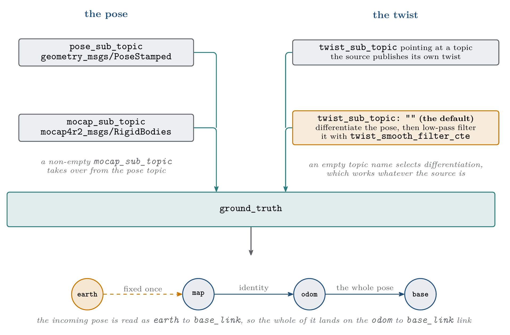

.. _as2_plugins_state_estimator_ground_truth:

============
Ground Truth
============

.. contents:: Contents
   :depth: 2
   :local:

State estimator plugin for sources that already give an absolute, essentially exact pose:
the ground truth of a simulator, or a motion capture system.

There is no filtering and no fusion here. The pose is taken at face value and turned into
the transform tree. For a source that is noisy, slow or delayed, use
:ref:`simple_ekf <as2_plugins_state_estimator_simple_ekf>` instead.

.. _as2_plugins_state_estimator_ground_truth_working:

-----------------
Working Principle
-----------------

The incoming pose is read as ``earth`` to ``base_link``. Since the tree has to stay
connected, the plugin fixes ``earth`` to ``map`` and ``map`` to ``odom``, and puts the whole
pose on ``odom`` to ``base_link``.

   Where the pose and the twist come from, and where the result lands

Poses have to arrive in the ``earth`` frame. A pose in any other frame is rejected with an
error, it is not transformed.

``earth`` to ``map`` is set once, either from the first pose received or from the
``earth_map_transform`` parameters. Anchoring it at the first pose means the drone starts at
the origin of its own ``map`` frame, which is what most missions expect.

Input modes
===========

The plugin reads a pose from one of two sources, and a twist from one of two:

.. list-table:: Pose and twist sources
   :widths: 20 20 30 30
   :header-rows: 1

   * - ``mocap_sub_topic``
     - ``twist_sub_topic``
     - Pose from
     - Twist from
   * - ``""``
     - ``""`` (default)
     - ``pose_sub_topic``
     - The differentiated pose, low-pass filtered
   * - ``""``
     - set
     - ``pose_sub_topic``
     - ``twist_sub_topic``
   * - set
     - ``""`` (default)
     - The named rigid body in ``mocap_sub_topic``
     - The differentiated pose, low-pass filtered
   * - set
     - set
     - The named rigid body in ``mocap_sub_topic``
     - ``twist_sub_topic``

``twist_sub_topic`` is empty by default, so the twist is differentiated from the pose. That
works for every source, including motion capture rigs and any simulator, which is why it is
the default. Point it at a topic only when the source publishes its own twist and you would
rather use that than a differentiated one.

.. warning::

   Pointing ``twist_sub_topic`` at a topic nobody publishes gives a node that never
   publishes a pose. ``self_localization/pose`` is published from the twist path, so if the
   named topic stays silent the node starts, logs nothing unusual, and produces TF but no
   pose. Leaving the parameter empty avoids this entirely, and is also what makes
   ``twist_smooth_filter_cte`` take effect.

.. _as2_plugins_state_estimator_ground_truth_parameters:

----------
Parameters
----------

Every parameter lives under the ``ground_truth:`` block.

.. list-table:: Ground Truth parameters
   :widths: 40 10 20 30
   :header-rows: 1

   * - Parameter
     - Type
     - Default
     - Description
   * - ``pose_sub_topic``
     - string
     - ``ground_truth/pose``
     - Pose input. Ignored when ``mocap_sub_topic`` is set
   * - ``twist_sub_topic``
     - string
     - ``""``
     - Twist input. Empty, the default, differentiates the pose instead
   * - ``twist_smooth_filter_cte``
     - double
     - ``1.0``
     - Low-pass constant in the range ``(0, 1]`` for the differentiated twist. ``1.0``
       applies no filtering, values closer to ``0`` filter more. Only used when
       ``twist_sub_topic`` is empty
   * - ``reject_repeated_positions``
     - bool
     - ``false``
     - Drop poses whose position repeats the last processed one. See the notes below before
       enabling it
   * - ``mocap_sub_topic``
     - string
     - ``""``
     - ``mocap4r2_msgs/msg/RigidBodies`` input. Empty disables the motion capture mode
   * - ``rigid_body_name``
     - string
     - ``33``
     - Rigid body to track. Only used in motion capture mode
   * - ``earth_map_transform.set_earth_map``
     - bool
     - ``false``
     - Pin ``earth`` to ``map`` from parameters instead of from the first pose
   * - ``earth_map_transform.position.{x,y,z}``
     - double
     - ``0.0``
     - Position of ``map`` inside ``earth``, in meters
   * - ``earth_map_transform.orientation.{roll,pitch,yaw}``
     - double
     - ``0.0``
     - Orientation of ``map`` inside ``earth``, in radians

.. _as2_plugins_state_estimator_ground_truth_examples:

--------
Examples
--------

Simulator
=========

Everything except the plugin name is already the default, so this is enough:

.. code-block:: yaml

   /**:
     ros__parameters:
       plugin_name: "ground_truth"
       base_frame: ""            # Gazebo roots the model TF at the bare model name

To take the twist from the simulator instead of differentiating the pose:

.. code-block:: yaml

   /**:
     ros__parameters:
       plugin_name: "ground_truth"
       base_frame: ""
       ground_truth:
         pose_sub_topic: "ground_truth/pose"
         twist_sub_topic: "ground_truth/twist"

Motion capture
==============

.. code-block:: yaml

   /**:
     ros__parameters:
       plugin_name: "ground_truth"
       ground_truth:
         mocap_sub_topic: "/mocap/rigid_bodies"
         rigid_body_name: "drone0"
         twist_smooth_filter_cte: 0.1   # heavy filtering: a differentiated mocap velocity is noisy
         reject_repeated_positions: true  # non-default: an exact repeat means the cameras lost it

``rigid_body_name`` should be quoted. An unquoted numeric name such as ``33`` is parsed as
an integer, and the plugin converts it back to a string with a warning.

.. note::

   To bring the motion capture data into ROS 2 we recommend the
   `mocap4ros2 <https://mocap4ros2-project.github.io/>`_ package.

Fixed map origin
================

.. code-block:: yaml

   ground_truth:
     earth_map_transform:
       set_earth_map: true
       position: {x: 1.0, y: 2.0, z: 0.0}
       orientation: {roll: 0.0, pitch: 0.0, yaw: 1.5708}

.. _as2_plugins_state_estimator_ground_truth_notes:

-----
Notes
-----

- **Orientation is not filtered.** ``twist_smooth_filter_cte`` applies to the
  differentiated linear velocity only. Orientation is passed through as it arrives. Feeding
  the motion capture topic to
  :ref:`simple_ekf <as2_plugins_state_estimator_simple_ekf>` instead gives smoothing as a
  side effect of the filter.
- **Angular velocity is differentiated too**, from the rotation between two consecutive
  orientations, and comes out already expressed in the base frame. It goes through the same
  ``twist_smooth_filter_cte`` low-pass as the linear velocity. Differentiated body rates are
  noisier than a gyroscope, so prefer a source that publishes its own twist when there is
  one.
- **Poses with a non increasing timestamp are always dropped**, whatever the source, since
  they are duplicated or out of order messages. No parameter controls this.
- **reject_repeated_positions drops poses that do not move**, within one micrometer of the
  last processed position. It is off by default, and whether you want it depends entirely on
  the source:

  - **Motion capture: enable it.** A tracked rigid body always jitters, so an exact repeat
    means the cameras lost it and the motion capture software is replaying its last known
    frame with fresh timestamps. Feeding those into the estimator makes a lost robot look
    stationary.
  - **Simulator, or any source reporting an exact position: leave it off.** There a repeat
    genuinely means the robot is not moving. Enabling it makes the plugin stop publishing
    entirely while the robot holds still, no TF, no pose and no twist, and the state freezes
    at the last timestamp it moved.

  Only the position is compared, never the orientation, so a robot rotating perfectly in
  place is dropped as well when this is on.
- **All-zero motion capture poses are dropped**, since motion capture systems publish those
  for a rigid body they have lost track of.
- **There is no GPS path in this plugin.** GPS lives on
  :ref:`raw_odometry <as2_plugins_state_estimator_raw_odometry>`.
