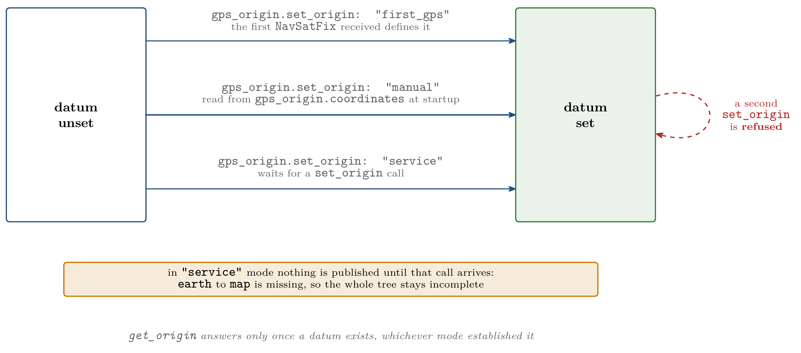

.. _as2_plugins_state_estimator_raw_odometry:

============
Raw Odometry
============

.. contents:: Contents
   :depth: 2
   :local:

State estimator plugin that republishes an odometry the platform has already computed,
optionally anchoring the transform tree to a GPS datum.

Use it when the autopilot or the sensor stack does the fusion: PX4, DJI, a Crazyflie flow
deck, a RealSense tracking camera, or any driver publishing a ``nav_msgs/msg/Odometry``.

.. _as2_plugins_state_estimator_raw_odometry_working:

-----------------
Working Principle
-----------------

The incoming odometry is taken as the ``odom`` to ``base_link`` transform, and its twist as
the body velocity. ``map`` to ``odom`` is the identity: this plugin applies no correction,
it forwards what it is given.

The frame ids on the incoming message are not trusted. If ``header.frame_id`` is not the
odom frame, or ``child_frame_id`` is not the base frame, the plugin warns once and
overrides them.

Where ``earth`` to ``map`` comes from depends on two parameters:

.. list-table:: Origin of the ``earth`` to ``map`` transform
   :widths: 15 20 65
   :header-rows: 1

   * - ``use_gps``
     - ``set_earth_map``
     - ``earth`` to ``map``
   * - ``false``
     - ``false``
     - Identity. ``map`` and ``earth`` coincide
   * - ``false``
     - ``true``
     - The pose given in ``earth_map_transform``
   * - ``true``
     - ``false``
     - Placed at the first GPS fix, expressed relative to the datum
   * - ``true``
     - ``true``
     - The pose given in ``earth_map_transform``. GPS supplies only the datum

.. note::

   ``map`` to ``odom`` is always the identity, so any drift in the platform odometry
   propagates straight through to the published pose. To correct it from an absolute
   source, use :ref:`simple_ekf <as2_plugins_state_estimator_simple_ekf>`.

.. _as2_plugins_state_estimator_raw_odometry_parameters:

----------
Parameters
----------

Every parameter lives under the ``raw_odometry:`` block.

.. list-table:: Raw Odometry parameters
   :widths: 40 10 20 30
   :header-rows: 1

   * - Parameter
     - Type
     - Default
     - Description
   * - ``odom_sub_topic``
     - string
     - ``sensor_measurements/odom``
     - Odometry input topic
   * - ``earth_map_transform.set_earth_map``
     - bool
     - ``false``
     - Pin ``earth`` to ``map`` from parameters instead of letting it be derived
   * - ``earth_map_transform.position.{x,y,z}``
     - double
     - ``0.0``
     - Position of ``map`` inside ``earth``, in meters
   * - ``earth_map_transform.orientation.{roll,pitch,yaw}``
     - double
     - ``0.0``
     - Orientation of ``map`` inside ``earth``, in radians
   * - ``use_gps``
     - bool
     - ``false``
     - Anchor the ``earth`` frame at a geodetic datum
   * - ``gps_origin.set_origin``
     - string
     - ``first_gps``
     - Where the datum comes from: ``first_gps``, ``manual`` or ``service``
   * - ``gps_origin.coordinates.latitude``
     - double
     - ``0.0``
     - Datum latitude in degrees, WGS84
   * - ``gps_origin.coordinates.longitude``
     - double
     - ``0.0``
     - Datum longitude in degrees
   * - ``gps_origin.coordinates.altitude``
     - double
     - ``0.0``
     - Datum altitude in meters, using the same convention as the GPS fixes

A minimal configuration:

.. code-block:: yaml

   /**:
     ros__parameters:
       plugin_name: "raw_odometry"
       raw_odometry:
         odom_sub_topic: "sensor_measurements/odom"

.. _as2_plugins_state_estimator_raw_odometry_gps:

---
GPS
---

``use_gps: true`` gives the tree a **geodetic datum**: a latitude, longitude and altitude
that the origin of the ``earth`` frame sits on. Everything downstream stays in meters, but
those meters then mean something on the planet, which is what lets a mission be written in
GPS coordinates and what ``get_origin`` reports to the rest of the system.

Enabling it adds:

.. list-table:: Interfaces added by ``use_gps``
   :widths: 30 30 40
   :header-rows: 1

   * - Interface
     - Type
     - Purpose
   * - ``sensor_measurements/gps``
     - ``sensor_msgs/msg/NavSatFix``
     - Input. Only the **first** fix is read, then the subscription is dropped
   * - ``set_origin``
     - ``as2_msgs/srv/SetOrigin``
     - Supply the datum at run time
   * - ``get_origin``
     - ``as2_msgs/srv/GetOrigin``
     - Query the datum

Choosing the datum
==================

   The three ways of establishing the geodetic datum

.. list-table:: ``gps_origin.set_origin`` modes
   :widths: 15 30 55
   :header-rows: 1

   * - Mode
     - The datum comes from
     - Use it when
   * - ``first_gps``
     - The first fix received
     - Normal outdoor flight. Take off from wherever you are and treat that point as the
       origin
   * - ``manual``
     - ``gps_origin.coordinates``
     - Repeated flights over the same site, or several drones that have to share one origin
       so their local coordinates agree
   * - ``service``
     - A ``set_origin`` call
     - A ground station or a mission script decides the origin at run time

In ``manual`` and ``service`` modes the first fix is still needed, but only to work out
*where the drone is* relative to the datum. In ``service`` mode that fix is held aside
until the call arrives.

The datum can only be established once. Whichever source wins, later ``set_origin`` calls
are answered with ``success: false``. ``get_origin`` answers as soon as a datum exists.

.. warning::

   In ``service`` mode the transform tree stays incomplete until ``set_origin`` is called.
   ``earth`` to ``map`` is not published before that, so nothing downstream can resolve a
   pose, and the estimator looks like it has hung. The startup log states this explicitly.

An unrecognised value for ``set_origin`` logs a warning and falls back to ``first_gps``.

.. _as2_plugins_state_estimator_raw_odometry_examples:

--------
Examples
--------

Take the origin from the first fix:

.. code-block:: yaml

   raw_odometry:
     use_gps: true
     gps_origin:
       set_origin: "first_gps"
       coordinates: {latitude: 0.0, longitude: 0.0, altitude: 0.0}

A fixed site origin, shared between flights and between drones:

.. code-block:: yaml

   raw_odometry:
     use_gps: true
     gps_origin:
       set_origin: "manual"
       coordinates:
         latitude: 40.4378698
         longitude: -3.8196207
         altitude: 660.0

A fixed site origin together with a known starting position inside it.
``earth_map_transform`` places ``map``, and GPS supplies the datum:

.. code-block:: yaml

   raw_odometry:
     use_gps: true
     earth_map_transform:
       set_earth_map: true
       position: {x: 10.0, y: -5.0, z: 0.0}
       orientation: {roll: 0.0, pitch: 0.0, yaw: 1.5708}
     gps_origin:
       set_origin: "manual"
       coordinates: {latitude: 40.4378698, longitude: -3.8196207, altitude: 660.0}

Wait for a ground station to set the origin:

.. code-block:: yaml

   raw_odometry:
     use_gps: true
     gps_origin:
       set_origin: "service"
       coordinates: {latitude: 0.0, longitude: 0.0, altitude: 0.0}

.. code-block:: bash

    ros2 service call /drone0/set_origin as2_msgs/srv/SetOrigin \
      "{origin: {latitude: 40.4378698, longitude: -3.8196207, altitude: 660.0}}"

.. warning::

   Every key has to be present in the YAML even when the selected mode does not use it.
   Parameters are declared without a fallback value, so a missing ``coordinates`` block
   stops the node whatever the mode is. This is why the examples above always carry the
   full block.
