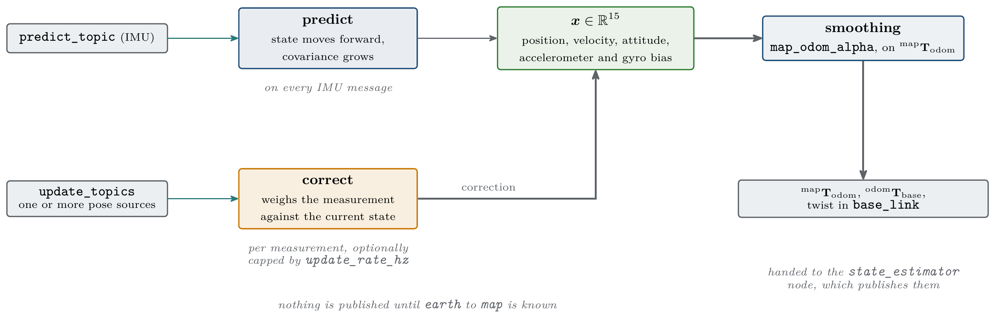
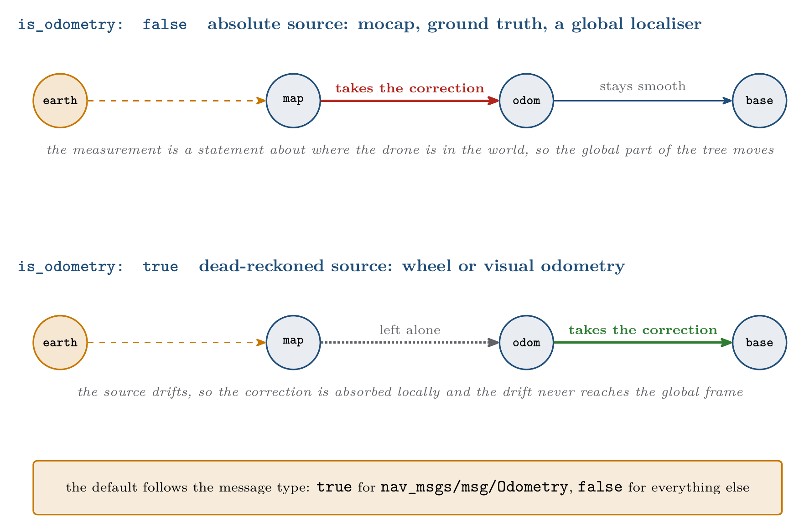
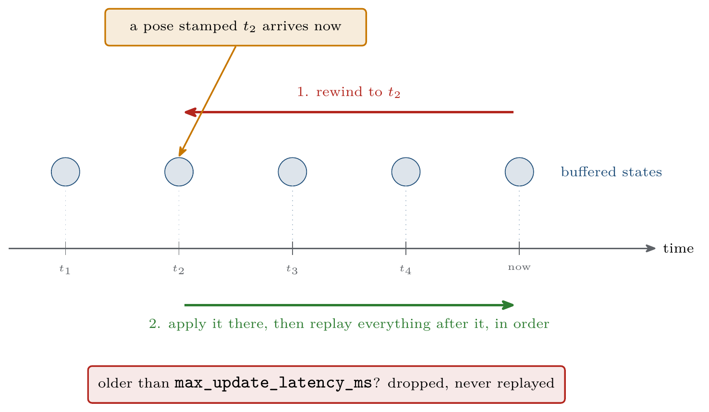
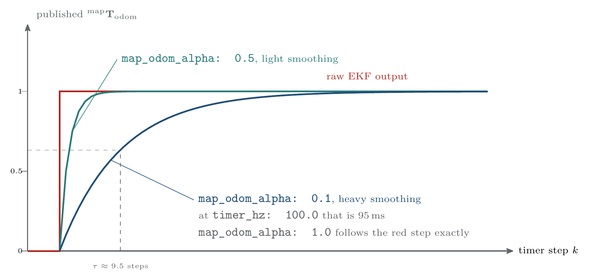

.. _as2_plugins_state_estimator_simple_ekf:

==========
Simple EKF
==========

.. contents:: Contents
   :depth: 2
   :local:

A 15 state Extended Kalman Filter that predicts on the IMU and corrects from a configurable
list of pose sources.

Use it when actual fusion is needed: a pose source that is slow, noisy or delayed, several
sources at once, or a platform whose odometry drifts and has to be corrected from something
absolute.

The Jacobians of the filter are generated symbolically with
`CasADi <https://web.casadi.org/>`_ and compiled into the standalone ``ekf`` library that
ships inside the plugin.

.. _as2_plugins_state_estimator_simple_ekf_working:

-----------------
Working Principle
-----------------

   The predict and correct cycle, and what comes out of it

IMU messages drive the prediction step, and pose measurements correct it. Both publish
immediately afterwards, so in practice the IMU rate sets the output rate, since it is
normally the faster of the two. Nothing is published until ``earth`` to ``map`` is known.

State vector
============

.. list-table:: The 15 states
   :widths: 15 30 55
   :header-rows: 1

   * - Index
     - State
     - Notes
   * - 0 to 2
     - ``x, y, z``
     - Position in ``map``
   * - 3 to 5
     - ``vx, vy, vz``
     - Velocity
   * - 6 to 8
     - ``roll, pitch, yaw``
     - Orientation, as Euler angles
   * - 9 to 11
     - ``abx, aby, abz``
     - Accelerometer bias
   * - 12 to 14
     - ``wbx, wby, wbz``
     - Gyroscope bias

.. warning::

   Attitude is parametrised as Euler angles, which is singular at a pitch of plus or minus
   90 degrees. This is fine for normal flight and not suitable for aggressive or
   near-vertical manoeuvres.

Where a correction lands
========================

The filter produces one corrected pose, but that correction can be applied to the tree in
two different places, and picking the wrong one is the most common way to get bad results.

   ``is_odometry`` decides which link absorbs a correction

.. list-table:: ``is_odometry``
   :widths: 15 25 60
   :header-rows: 1

   * - Value
     - The correction moves
     - Right for
   * - ``false``
     - ``map`` to ``odom``
     - **Absolute, drift free** sources: motion capture, ground truth, a global localiser.
       The correction is a real statement about where the drone is in the world, so it
       belongs in the global part of the tree
   * - ``true``
     - ``odom`` to ``base_link``
     - **Dead reckoned, drifting** sources: wheel or visual odometry. The drift must not
       leak into the global frame, so the correction is absorbed locally and ``map`` to
       ``odom`` is left alone

The default is derived from the message type: ``true`` for ``nav_msgs/msg/Odometry``, and
``false`` for every other type. Set it per topic to override that.

Out-of-sequence measurements
============================

A pose that arrives stamped *earlier* than IMU predictions already applied is not simply
dropped. The plugin keeps a chronological buffer of every filter operation, rewinds to the
timestamp of the measurement, applies the correction there, and replays the intervening
predictions.

   Rewind and replay for a measurement that arrives late

This is what makes slow, heavily processed sources usable: a vision pipeline whose pose is
200 ms old still lands at the right point in the timeline. Anything older than
``max_update_latency_ms`` is dropped as stale.

Output smoothing
================

Every correction moves ``map`` to ``odom`` in a step. Handing that step straight to a
controller is not ideal, so the published ``map`` to ``odom`` is an exponential moving
average of the raw filter value:

.. math::

   x_\text{published} \leftarrow (1 - \alpha)\, x_\text{published} + \alpha\, x_\text{raw}

The blend is stepped only from the plugin timer, so its time constant is well defined:

.. math::

   \tau = \frac{-1}{f_{\text{timer}} \, \ln(1 - \alpha)}

where :math:`f_{\text{timer}}` is ``timer_hz`` and :math:`\alpha` is ``map_odom_alpha``.

   How the published transform follows a correction

``map_odom_alpha`` weights the **new** value: ``0.1`` is heavy smoothing, and ``1.0``
disables the smoothing and publishes the raw filter output. The plugin logs the resulting
time constant in milliseconds at startup.

Only the published copy is smoothed. The internal ``map`` to ``odom`` of the filter stays
raw, since it is used to transform incoming measurements. To compare the two, enable
``internal_ekf_debug_topics``: it publishes the raw pre-smoothing state with the same
timestamps as the external one, so the traces overlay exactly.

Pre-flight zero pose correction
===============================

Before the drone first goes offboard, or arms when ``use_arm: true``, it is known to be
sitting still at its origin. The plugin uses that: at every timer tick it corrects the
filter towards pose zero with a very low covariance. This pins the state and lets the IMU
biases converge while the drone waits on the ground.

Once the drone has been offboard at least once the correction is never applied again, even
after landing. Setting ``platform_topic: ""`` assumes offboard is always true and disables
the mechanism entirely.

.. _as2_plugins_state_estimator_simple_ekf_parameters:

----------
Parameters
----------

Every parameter lives under the ``simple_ekf:`` block.

Core
====

.. list-table:: Core parameters
   :widths: 30 10 25 35
   :header-rows: 1

   * - Parameter
     - Type
     - Default
     - Description
   * - ``predict_topic``
     - string
     - ``sensor_measurements/imu``
     - IMU input. Drives the prediction step and, in practice, the output rate
   * - ``update_topics``
     - string list
     - ``["posestamped1"]``
     - Names of the per-topic configuration blocks to load
   * - ``timer_hz``
     - double
     - ``100.0``
     - Timer rate. Sets the smoothing time constant, the rate at which ``earth`` to ``map``
       is republished when ``static_tf`` is false, and the rate of the pre-offboard
       correction
   * - ``map_odom_alpha``
     - double
     - ``0.1``
     - Output smoothing weight on the new value, in the range ``(0, 1]``. ``1.0`` disables
       it
   * - ``max_update_latency_ms``
     - double
     - ``1000.0``
     - Maximum age of a measurement before it is dropped
   * - ``gravity``
     - double
     - ``9.81``
     - Gravitational acceleration in m/s²
   * - ``platform_topic``
     - string
     - ``platform/info``
     - Platform status used by the pre-flight correction. Empty assumes always offboard
   * - ``use_arm``
     - bool
     - ``false``
     - Gate the pre-flight correction on ``armed`` rather than on ``offboard``
   * - ``verbose``
     - bool
     - ``true``
     - Startup and operational logging
   * - ``debug_verbose``
     - bool
     - ``false``
     - Per-message state and covariance logging. Very noisy
   * - ``debug_publish_hz``
     - double
     - ``-1.0``
     - Rate of the ``state_estimation/simple_ekf/*`` topics. ``-1`` publishes on every
       update, ``0`` disables them
   * - ``internal_ekf_debug_topics``
     - string
     - ``""``
     - Base name for the raw pre-smoothing debug topics. Empty disables them

IMU noise
=========

.. list-table:: IMU noise parameters
   :widths: 60 15 25
   :header-rows: 1

   * - Parameter
     - Type
     - Default
   * - ``imu_params.accelerometer_noise_density``
     - double
     - ``1e-3``
   * - ``imu_params.gyroscope_noise_density``
     - double
     - ``1e-4``
   * - ``imu_params.accelerometer_random_walk``
     - double
     - ``1e-4``
   * - ``imu_params.gyroscope_random_walk``
     - double
     - ``1e-5``

These feed the process noise covariance. Use the values from the datasheet of your IMU, or
from an Allan variance analysis if you have one.

Initial covariance
==================

.. list-table:: Initial covariance
   :widths: 40 10 15 35
   :header-rows: 1

   * - Parameter
     - Type
     - Default
     - Applies to
   * - ``initial_covariance.position``
     - double
     - ``0.0``
     - ``x, y, z``
   * - ``initial_covariance.velocity``
     - double
     - ``0.0``
     - ``vx, vy, vz``
   * - ``initial_covariance.orientation``
     - double
     - ``0.0``
     - ``roll, pitch, yaw``
   * - ``initial_covariance.bias_acc``
     - double
     - ``1e-8``
     - Accelerometer bias
   * - ``initial_covariance.bias_gyro``
     - double
     - ``1e-8``
     - Gyroscope bias

A zero means the initial state is taken as exactly known, which is reasonable here because
the drone genuinely starts at the origin of its own ``map`` frame.

earth to map
============

.. list-table:: ``earth_map_transform``
   :widths: 40 10 15 35
   :header-rows: 1

   * - Parameter
     - Type
     - Default
     - Description
   * - ``earth_map_transform.static_tf``
     - bool
     - ``true``
     - Publish ``earth`` to ``map`` on ``/tf_static`` rather than republishing it on
       ``/tf`` at ``timer_hz``
   * - ``earth_map_transform.set_earth_map``
     - bool
     - ``false``
     - Pin ``earth`` to ``map`` from parameters
   * - ``earth_map_transform.position.{x,y,z}``
     - double
     - ``0.0``
     - Position of ``map`` inside ``earth``, in meters
   * - ``earth_map_transform.orientation.{roll,pitch,yaw}``
     - double
     - ``0.0``
     - Orientation of ``map`` inside ``earth``, in radians

If no update topic sets ``set_earth_map: true`` and ``set_earth_map`` is false here, the
transform is published as the identity as soon as the first IMU message arrives, so the
tree is never left dangling.

Per-topic configuration
=======================

Each name listed in ``update_topics`` refers to a sibling block:

.. list-table:: Per-topic parameters
   :widths: 25 15 20 40
   :header-rows: 1

   * - Parameter
     - Type
     - Required
     - Description
   * - ``topic``
     - string
     - yes
     - Topic to subscribe to
   * - ``type``
     - string
     - yes
     - One of ``geometry_msgs/msg/PoseStamped``,
       ``geometry_msgs/msg/PoseWithCovarianceStamped``, ``nav_msgs/msg/Odometry`` or
       ``mocap4r2_msgs/msg/RigidBodies``
   * - ``set_earth_map``
     - bool
     - yes
     - Bootstrap ``earth`` to ``map`` from the first message on this topic
   * - ``use_message_covariance``
     - bool
     - yes
     - Use the covariance carried by the message, scaled by the multipliers, instead of
       fixed values
   * - ``position_covariance``
     - double[3]
     - when ``use_message_covariance`` is false
     - Fixed variances for ``x, y, z``
   * - ``orientation_covariance``
     - double[3]
     - when ``use_message_covariance`` is false
     - Fixed variances for ``roll, pitch, yaw``
   * - ``position_multiplier``
     - double[3]
     - optional
     - Scale applied to the position covariance of the message. Defaults to ``[1, 1, 1]``
   * - ``orientation_multiplier``
     - double[3]
     - optional
     - Scale applied to the orientation covariance of the message. Defaults to
       ``[1, 1, 1]``
   * - ``rigid_body_name``
     - string
     - for ``RigidBodies``
     - Rigid body to track. Quote it
   * - ``update_rate_hz``
     - double
     - optional
     - Cap on how often this topic feeds the filter. ``0`` or absent means no limit
   * - ``is_odometry``
     - bool
     - optional
     - Which link absorbs the correction. Defaults from ``type``
   * - ``reject_repeated_positions``
     - bool
     - optional
     - Drop messages repeating the last position seen on this topic. Defaults from ``type``:
       ``true`` for ``RigidBodies``, ``false`` for everything else

``RigidBodies`` carries no covariance, so ``use_message_covariance`` has to be false for it.

Repeated positions
==================

Each topic is compared only against its own last accepted position, so one source stalling
does not affect the others. Only the position is compared, never the orientation, and
timestamps play no part: a message is judged solely on whether its position moved.

The default follows the message type, because what a repeat *means* depends on the source:

- ``mocap4r2_msgs/msg/RigidBodies`` **defaults to** ``true``. A motion capture system keeps
  publishing the last known pose when its cameras lose the rigid body, and since a tracked
  body always jitters, an exact repeat means the tracking dropped rather than that the drone
  is still. This matters more for a filter than for a pass through estimator: every update
  is treated as independent new information, so re-feeding the same measurement shrinks the
  state covariance as if the motion capture had confirmed the position again. Left
  unchecked, the filter grows confident about a position nobody is measuring and stops
  trusting the IMU exactly when the IMU is all it has.
- **Every other type defaults to** ``false``, since an exact repeat there usually means the
  drone is not moving, which is legitimate data.

Dropping an update does not stop the estimator: the IMU prediction and the publish timer
keep running, so the state keeps being published. What is lost is a correction, not the
output.

.. warning::

   Parameters are declared without a fallback value, so anything a block references has to
   exist in the YAML. When copying a commented-out example, uncomment the whole block.

.. _as2_plugins_state_estimator_simple_ekf_examples:

--------
Examples
--------

A single absolute pose source
=============================

.. code-block:: yaml

   /**:
     ros__parameters:
       plugin_name: "simple_ekf"
       simple_ekf:
         predict_topic: "sensor_measurements/imu"
         update_topics: ["gt"]
         gt:
           topic: "ground_truth/pose"
           type: "geometry_msgs/msg/PoseStamped"
           set_earth_map: true
           use_message_covariance: false
           position_covariance: [1e-4, 1e-4, 1e-4]
           orientation_covariance: [1e-5, 1e-5, 1e-5]

Motion capture
==============

.. code-block:: yaml

   simple_ekf:
     update_topics: ["mocap"]
     mocap:
       topic: "/mocap/rigid_bodies"
       type: "mocap4r2_msgs/msg/RigidBodies"
       rigid_body_name: "drone0"
       set_earth_map: true
       use_message_covariance: false
       position_covariance: [1e-4, 1e-4, 1e-4]
       orientation_covariance: [1e-5, 1e-5, 1e-5]
       update_rate_hz: 50.0
       is_odometry: false
       reject_repeated_positions: true   # the default for this type, shown for clarity

A drifting odometry corrected by an absolute source
===================================================

The classic reason to run an EKF. Visual odometry gives a smooth, high rate but drifting
pose, and a slower absolute source pins it to the world.

.. code-block:: yaml

   simple_ekf:
     update_topics: ["vo", "global"]

     vo:
       topic: "sensor_measurements/odom"
       type: "nav_msgs/msg/Odometry"
       set_earth_map: false        # its origin is arbitrary, do not anchor the tree to it
       use_message_covariance: true
       position_multiplier: [1.0, 1.0, 1.0]
       orientation_multiplier: [1.0, 1.0, 1.0]
       # is_odometry defaults to true for this type: the drift stays out of map to odom

     global:
       topic: "global_localization/pose"
       type: "geometry_msgs/msg/PoseWithCovarianceStamped"
       set_earth_map: true
       use_message_covariance: true
       position_multiplier: [1.0, 1.0, 1.0]
       orientation_multiplier: [1.0, 1.0, 1.0]
       update_rate_hz: 5.0
       is_odometry: false          # absolute: allowed to move map to odom

.. _as2_plugins_state_estimator_simple_ekf_tuning:

------
Tuning
------

.. list-table:: Tuning guide
   :widths: 50 50
   :header-rows: 1

   * - Symptom
     - Try
   * - The pose jumps visibly when a correction arrives
     - Lower ``map_odom_alpha``
   * - The pose lags behind reality
     - Raise ``map_odom_alpha``, or set it to ``1.0`` to publish the raw output
   * - The filter ignores a source
     - Its covariance is too high relative to the others. Lower it
   * - The filter follows a noisy source too closely
     - Raise the covariance of that source
   * - The position drifts while the drone is stationary
     - Check the IMU noise parameters, and confirm the pre-flight correction is running,
       which needs ``platform_topic`` to be reachable
   * - A delayed source seems to have no effect
     - Compare its latency against ``max_update_latency_ms``

Enable ``internal_ekf_debug_topics`` and plot it against ``self_localization/pose`` to tell
a filter problem apart from a smoothing problem.

.. _as2_plugins_state_estimator_simple_ekf_debug:

------------
Debug topics
------------

.. list-table:: Debug topics
   :widths: 45 55
   :header-rows: 1

   * - Topic
     - Content
   * - ``state_estimation/simple_ekf/pose``, ``.../twist``
     - The state as reported by the plugin, before the authority check of the node. Rate
       set by ``debug_publish_hz``
   * - ``<internal_ekf_debug_topics>/pose``, ``/twist``, ``/map_to_odom``
     - The raw pre-smoothing filter state, with the same timestamps as the external state

For example, ``internal_ekf_debug_topics: "debug/internal_ekf_state"`` publishes
``<ns>/debug/internal_ekf_state/pose``, ``/twist`` and ``/map_to_odom``.

.. warning::

   ``debug_verbose: true`` shuts the node down on a large jump. If a correction moves the
   position by more than one meter in a single step, the plugin logs an error and calls
   ``rclcpp::shutdown()`` so the state can be inspected. This is a diagnostic aid rather
   than something to have on during a flight. Leave ``debug_verbose`` false unless you are
   chasing a divergence.

.. _as2_plugins_state_estimator_simple_ekf_library:

--------------
Implementation
--------------

The filter itself lives in ``plugins/simple_ekf/lib/ekf``, a standalone C++ library with no
ROS dependency. The process model, the measurement models and their Jacobians are written
once as CasADi symbolic expressions, exported as C code, and compiled together with a thin
Eigen wrapper. Prediction integrates the model with a fourth order Runge-Kutta step.

The library README in the ``as2_state_estimator`` package covers the model definition, the
C++ API and how to regenerate the C code after changing the symbolic model.
