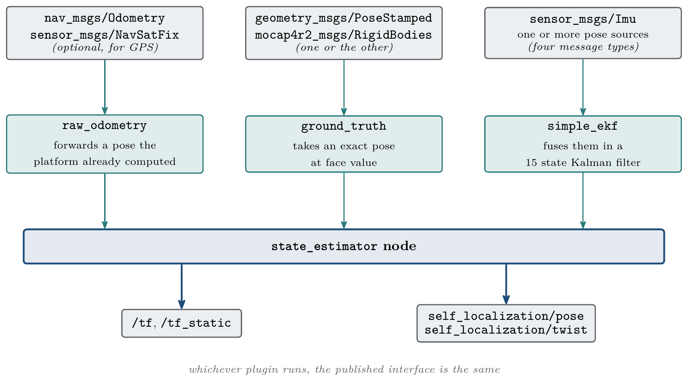

.. _as2_plugins:

===========
AS2 Plugins
===========

Aerostack2 is a modular framework, which means that it is possible to configure differents components to perform different tasks. 
In order to do that, Aerostack2 uses ROS 2 plugins. 
Plugins are libraries that are loaded at runtime. In this page, all avaliable plugins are listed.

.. _as2_plugins_motion_controller:

-------------------------
Motion Controller Plugins
-------------------------

.. list-table:: Motion Controller Plugins
   :widths: 50 50 50 50
   :header-rows: 1

   * - Name
     - Description
     - Avaliable control modes input
     - Avaliable control modes output
   * - PID Speed Controller
     - This plugin implements a PID controller for speed control.
     - | Hover
       | Speed with Yaw Angle or Yaw Speed
       | Speed in a Plane with Yaw Angle or Yaw Speed
       | Position with Yaw Angle or Yaw Speed
       | Trajectory with Yaw Angle or Yaw Speed
     - Speed with Yaw Angle or Yaw Speed
   * - Differential Flatness Controller
     - This plugin implements a differential flatness based controller.
     - | Hover
       | Trajectory with Yaw Angle or Yaw Speed
     - ACRO

.. _as2_plugins_state_estimator:

-----------------------
State Estimator Plugins
-----------------------

State Estimator plugins turn the measurements available on a given platform into the robot
state and the transform tree. The plugin is selected with the ``plugin_name`` parameter, and
its own parameters live in a block named after it. See
:ref:`State Estimator <as2_concepts_state_estimator>` for how the component and its plugins
fit together.

   What each plugin consumes, and the output path they share

.. list-table:: State Estimator Plugins
   :widths: 25 75
   :header-rows: 1

   * - Name
     - Description
   * - :ref:`Raw Odometry <as2_plugins_state_estimator_raw_odometry>`
     - Republishes an odometry the platform has already computed, such as the one coming
       from an autopilot or an onboard tracking sensor. Optionally anchors the tree to a GPS
       datum.
   * - :ref:`Ground Truth <as2_plugins_state_estimator_ground_truth>`
     - Takes an absolute, essentially exact pose at face value. Reads it either from a pose
       topic or directly from a motion capture system, and computes the twist when the
       source does not provide one.
   * - :ref:`Simple EKF <as2_plugins_state_estimator_simple_ekf>`
     - Fuses an IMU with an arbitrary list of pose sources in a 15 state Extended Kalman
       Filter. Handles delayed measurements, drifting sources and output smoothing.

.. toctree::
   :maxdepth: 1

   _state_estimator/raw_odometry.rst
   _state_estimator/ground_truth.rst
   _state_estimator/simple_ekf.rst

.. _as2_plugins_behaviors:

-----------------------
Behaviors Plugins
-----------------------

.. _as2_plugins_behaviors_motion:

Motion Behaviors Plugins
========================

.. list-table:: Motion Behaviors Plugins
   :widths: 50 50 50
   :header-rows: 1

   * - Behavior
     - Name
     - Description
   * - Take Off
     - Speed
     - Send a speed command in z axis to the aircraft base link to take off
   * - Take Off
     - Position
     - Send a position reference to take off
   * - Take Off
     - Platform
     - Use the platform take off service
   * - Take Off
     - Trajectory
     - Generate a trajectory to take off
   * - Land
     - Speed
     - Send a speed command in z axis to the aircraft base link to land
   * - Land
     - Platform
     - Use the platform land service
   * - Go To
     - Position
     - Send a position reference to desired position
   * - Go To
     - Trajectory
     - Generate a trajectory to go to desired position
   * - Follow Path
     - Position
     - Send a position reference to desired path waypoints
   * - Follow Path
     - Trajectory
     - Generate a trajectory to move along desired path waypoints

.. _as2_plugins_behaviors_trajectory_generation:

Trajectory Generation Behavior Plugins
======================================

.. list-table:: Trajectory Generation Behavior Plugins
   :widths: 35 65
   :header-rows: 1

   * - Name
     - Description
   * - mav_trajectory_generator
     - Wrapper around the ``mav_trajectory_generation_library`` (static polynomial generator with linear or NLopt-based nonlinear solver). Uses regenerate semantics on every modify.
   * - dynamic_mav_trajectory_generator
     - Wrapper around ``dynamic_trajectory_generator``. Supports smooth online stitching (``updateWaypoints`` replans without breaking the time axis). Recommended for long missions with frequent ``on_modify`` requests.
   * - jerk_limited_trajectory_generator
     - S-curve simulator (PX4-style jerk-limited profile) enforcing per-axis jerk plus 3D-norm acceleration and speed bounds. Optional L1 corner-cut smoothing through ``acceptance_radius``.
   * - gcopter_trajectory_generator
     - L-BFGS-based optimiser (Aerostack2 fork of ZJU-FAST-Lab GCOPTER) with safe-flight-corridor support. Optimises a polynomial trajectory under hard dynamic limits and AABB corridors anchored on each user waypoint.

.. _as2_plugins_behaviors_follow_reference:

Follow Reference Behavior Plugins
=================================

.. list-table:: Follow Reference Behavior Plugins
   :widths: 35 65
   :header-rows: 1

   * - Name
     - Description
   * - follow_reference_plugin_position
     - Tracks the reference by sending position setpoints to the controller through the ``as2_motion_reference_handlers`` ``PositionMotion`` handler. Setpoints emitted in ``earth`` so moving target frames work transparently.
   * - follow_reference_plugin_trajectory
     - Delegates tracking to ``TrajectoryGeneratorBehavior`` in ``follow_reference_mode``. Supports reactive modify under target drift via ``modify_threshold`` and ``modify_frequency``.

